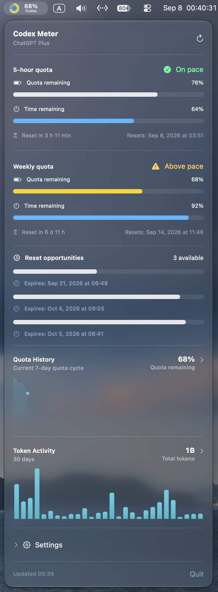
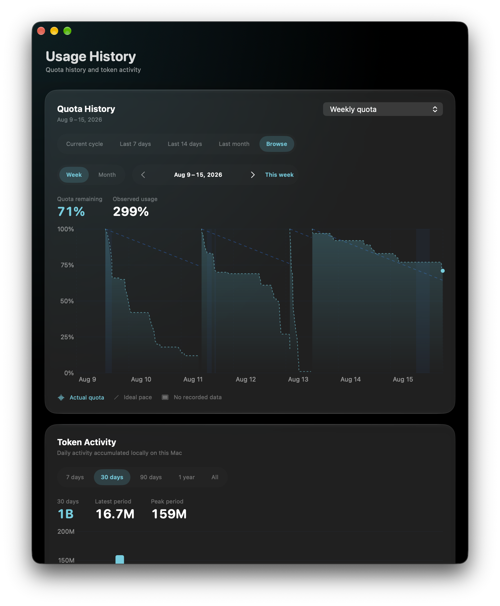
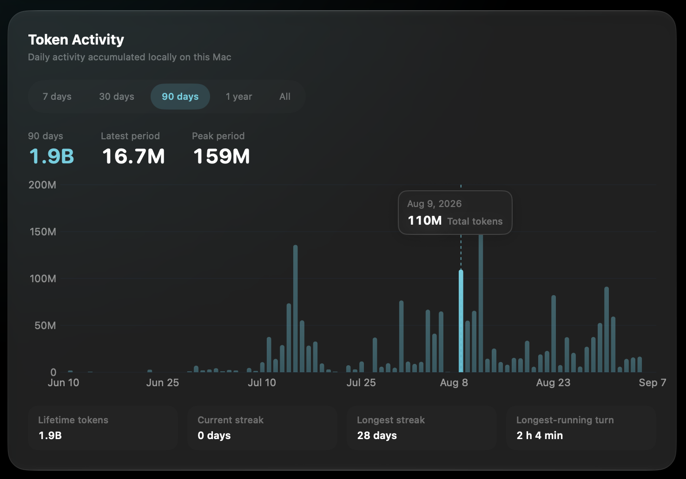
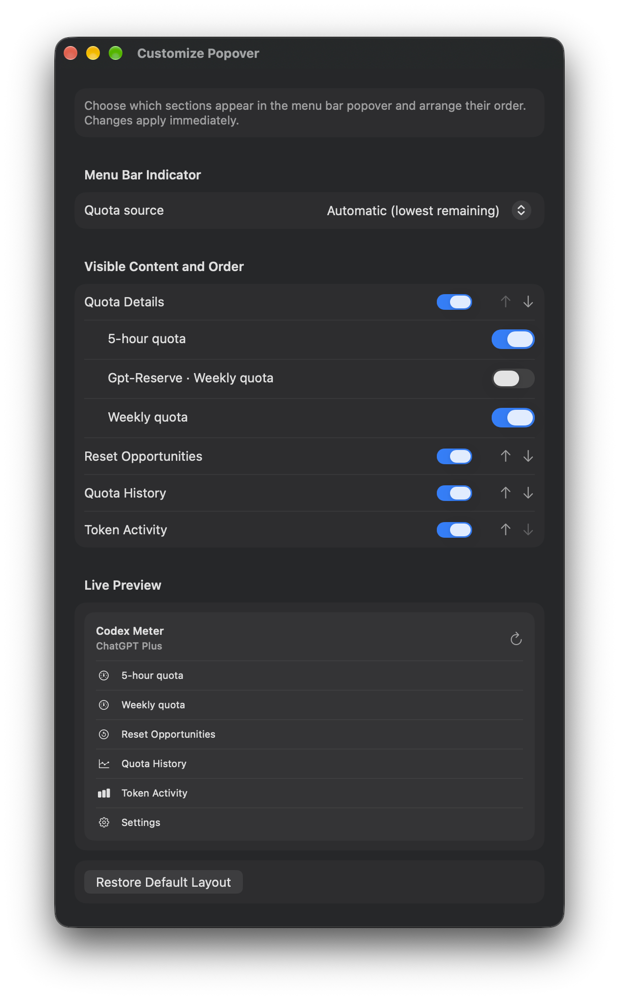

# HalfTank

HalfTank is a native macOS menu bar app that keeps your AI subscription limits
visible at a glance. It reads Codex account quota and, with the same rings,
charts, and history, OpenCode Go limits.


> [!NOTE]
> HalfTank is an unofficial community project. It is not affiliated with or
> endorsed by OpenAI or any other model provider.

## Credits and provenance

HalfTank is not a from-scratch app. It is a derivative of
**[CodexMeter](https://github.com/raycalrui/CodexMeter)** by Raycal, released
under the MIT license, and that project deserves the credit for the parts that
make this pleasant to use:

- the two-concentric-ring menu bar indicator and its customization options;
- the local SQLite quota history, charts, and backup/restore flow;
- the Codex App Server integration and the notification pipeline;
- the Sparkle build and release tooling.

What this repository changed on top of it:

- **OpenCode Go as a second quota source**, read through the official
  `opencode` CLI or, when its credentials are still valid, directly from the
  console API, with the 5-hour, weekly, and monthly Go meters kept in their own
  history partition.
- **Several accounts at once**, each Codex login isolated by its own
  `CODEX_HOME`, with a glass account switcher that keeps polling every account
  in the background.
- **A community reset estimate** from `pingreset.com`, with a per-signal
  explanation behind a help button and a permanent note that it is not an
  official guarantee.
- **An explainable exhaustion projection** fitted against active usage time
  rather than wall-clock time, using a recency-weighted Theil–Sen slope and
  reported as a range instead of a single number.
- **Reset credit guidance** that follows a chosen strategy: reach the official
  reset, or spend quota and refill as it runs dry.
- **An independent identity** — new bundle identifier, data directory, update
  feed, and update signing key — so this build can never silently update itself
  back to the upstream app.

The `CodexMeter` Xcode target name, the `CodexMeter/Core` directory, and the
upstream screenshots below are kept as-is so the lineage stays obvious.

## Preview

The screenshots come from the upstream CodexMeter project. The layout is
unchanged; only the app name and the new sections differ.

### Menu Bar Popover

<p align="center">
  
</p>

### Usage History

<p align="center">
  
</p>

### Interactive Token Activity

<p align="center">
  
</p>

### Customizable Popover

<p align="center">
  
</p>

## Features

- Shows a selected Codex quota directly in the macOS menu bar, with automatic
  fallback to the quota with the lowest remaining percentage.
- Uses two concentric progress rings:
  - outer ring: remaining quota;
  - inner ring: remaining time before reset.
- Highlights normal, over-pace, and low-quota states without relying on color
  alone.
- Displays the standard 5-hour and weekly Codex quota windows by default, with
  reset countdowns and detailed progress bars.
- Shows available banked Codex rate-limit resets as one compact lifetime
  progress bar and expiration time per reset. A one-line suggestion explains
  whether to spend one now, wait for an expected automatic reset, or use it
  before it expires, and it follows the reset strategy you pick: **reach the
  reset** saves quota for the official refill, **use it all** refills as soon as
  a window runs dry. This view is read-only and cannot redeem a reset.
- Shows the DeepSeek prepaid balance as money, with an optional budget that
  turns it into a ring, a menu bar percentage, and the same pace hints. The key
  comes from `DEEPSEEK_API_KEY` or the login keychain and never leaves the
  machine.
- Supports OpenCode Go as a second quota source. It shows the 5-hour, weekly,
  and monthly Go meters with the same rings, pace hints, reset countdowns, and
  quota history, and keeps OpenCode's history in its own local partition.
- Monitors every configured account at the same time. All of them keep
  refreshing in the background; a rounded glass switcher at the top of the
  popover moves between them, each segment carries its own most-constrained
  percentage, and the control becomes a menu once more accounts are added.
- Watches several Codex logins side by side. Each Codex account is one
  `CODEX_HOME` folder, added from Settings, with its own quota, its own menu bar
  ring choice, and its own history partition.
- Optionally shows the community's daily Codex reset estimate: the probability
  of a reset today, the last and next expected reset, and the signals behind the
  number. The section is opt-in and always labelled as an estimate, never as an
  OpenAI guarantee.
- Compares remaining quota with remaining time to indicate whether consumption
  is on pace.
- Estimates when a window will run dry once enough recent samples exist. The
  projection is paced by active usage time and median-based so one burst cannot
  define the trend, and it reports a range with a "follows active usage time"
  hint when the account has been idle for much of the sampled span. The same fit
  projects when a window would reach a higher floor, which is the moment the
  reset advice tells you to spend a banked reset.
- Refreshes quota on launch, every 10 seconds while the menu is open, every
  60 seconds in the background, after a Codex rate-limit update, and on manual
  request. Account checks and Token Activity polling stay at
  one-minute intervals. Failed automatic refreshes back off up to five minutes;
  unchanged token responses do not rewrite history.
- Detects Codex account changes and switches quota data without requiring an app
  restart.
- Supports standalone and npm-installed Codex CLI launchers by supplying common
  local runtime paths to the App Server child process.
- Preserves the last successful result and marks it as stale when refresh fails.
- Supports optional low-quota and over-pace notifications.
- Supports optional quota-replenishment reminders through Bark, Gotify,
  Telegram bots, and Discord webhooks, with independent channel switches,
  test messages, delivery status, bounded retries, and Keychain credential storage.
- Supports launch at login.
- Includes English, Simplified Chinese, and Traditional Chinese.
- Lets the app interface follow the system appearance or stay in Light or Dark
  mode independently.
- Offers ring, horizontal-bar, stacked-bar, percentage-only, and progress-only
  menu bar styles.
- Lets users independently show, hide, and reorder quota details, reset
  opportunities, Quota History, and Token Activity in the popover. Each returned
  quota window has its own visibility switch, and the menu bar indicator can use
  a chosen window or the automatic lowest-remaining fallback. The default
  popover shows Reset Opportunities, Quota History, and Token Activity while
  keeping the GPT-Reserve weekly quota hidden.
- Includes developer options with presets, custom quota/time sliders, live
  preview, safe appearance controls,
  deterministic quota-state presets, JSON configuration export, and a one-click
  reset to the accepted 1.0 appearance. Developer-only test data can populate
  30 days of quota history and simulate an available app update.
- Records local quota history as changes plus 15-minute anchors. The full chart
  defaults to the current seven-day reset cycle and can also show the rolling
  last 7 days, 14 days, or month, plus browsable calendar weeks and months.
  Historical ranges show observed quota consumption across reset cycles and
  label incomplete totals as lower bounds instead of estimating missing use.
  Each reset cycle remains a separate smooth curve beginning at 100%, with long
  unrecorded periods visibly shaded.
- Shows a compact view of the current weekly quota cycle plus the last 30 days
  of token activity directly in the menu-bar popover. The full history window
  can switch token activity between 7 days, 30 days, 90 days, one year, and all
  locally retained data. One-year data is grouped by week and all-time data by
  month to remain readable. Token values use compact `k`, `M`, and `B` units
  instead of scientific notation.
- Keeps the menu-bar popover compact with divider-separated quota and token
  sections rather than nested card backgrounds.
- Provides a resizable, full-screen-capable history window with an integrated
  transparent title bar. Hovering a token bar smoothly highlights its bucket,
  keeps the rule and date centered across every range, and reveals its exact day
  or grouped week/month plus compact token count.
- Shows optional daily and summary token activity from `account/usage/read`
  when the current Codex account supports it.
- Accumulates returned daily token buckets locally, clears them on an explicit
  account change, and supports 7-, 30-, 90-day, one-year, or unlimited local
  retention, storage-size reporting, CSV export, and history clearing. CSV
  exports include both the raw Unix timestamp and a readable ISO 8601 local
  time with its UTC offset.
- Uses native Liquid Glass cards and controls on macOS 26, with the same modern
  chart layout and a system-material fallback on earlier supported macOS.
- Includes an About window and Sparkle-based signed updates. It checks daily,
  supports one-click download/install/relaunch, and can optionally download and
  install future updates automatically.

## How It Works

Changed digits in the menu bar percentage briefly turn red when quota decreases,
hold red for half a second, then smoothly fade back over two seconds; the percent sign keeps its normal color.

HalfTank launches the locally installed Codex CLI as:

```text
codex app-server --listen stdio://
```

It then communicates with App Server using newline-delimited JSON-RPC messages:

1. Initialize the local App Server connection.
2. Read account metadata with `account/read`.
3. Read ChatGPT rate-limit windows with `account/rateLimits/read`.
4. Read optional banked-reset availability from the same rate-limit response.
5. Optionally read token activity with `account/usage/read` when supported.
6. Record successful quota snapshots and token summaries in account-separated
   local SQLite partitions. ChatGPT accounts use a salted, one-way local key;
   account email and authentication data are never stored.
7. Refresh when `account/updated` or `account/rateLimits/updated` is received.
8. Recover a stale authentication session by restarting only the local App
   Server child process once.
9. Calculate remaining quota, remaining time, consumption pace, and eligible
   history estimates locally.

HalfTank does not scrape ChatGPT pages, read Codex authentication files, or
store access tokens. Authentication and token refresh remain owned by Codex.

Codex App Server is currently an experimental interface intended for local
development and debugging, so future Codex releases may require compatibility
updates. See the official [Codex App Server documentation](https://learn.chatgpt.com/docs/app-server).

### OpenCode Go

OpenCode Go is the second tab of the popover, and it reads the Go limits of the
OpenCode workspace you are already signed in to. Choosing a quota source in
Settings only picks the tab shown first. Two
connections are available, and the app falls back to the other one whenever the
preferred connection fails:

1. **Official CLI (default).** HalfTank runs

   ```text
   opencode api --standalone experimental.usage.limits
   ```

   and reads the JSON it prints. The CLI owns authentication, so it also
   refreshes an expired session token by itself.
2. **Direct API (faster).** HalfTank reads the OpenCode OAuth credential from
   `opencode.db` inside OpenCode's data directory (`$XDG_DATA_HOME/opencode`, or
   `~/.local/share/opencode`) with a read-only SQLite connection, then calls
   `GET https://opencode.ai/zen/go/v1/usage` with that token and the workspace
   identifier. The database is never modified. If the stored token has already
   expired, HalfTank falls back to the CLI instead of refreshing it, because
   refreshing the token would rotate the credential OpenCode is using.

OpenCode Go limits are monthly dollar budgets. The 5-hour window corresponds to
20% of that budget, the weekly window to 50%, and the monthly window to 100%, so
the same three meters answer both "can I keep going now" and "will this last the
week". The monthly meter returns only its reset moment, so HalfTank treats the
cycle as the calendar month that ends there; that gives the monthly row the same
remaining-time bar as the other windows while its history stays in one bucket. OpenCode Go also exposes per-model budgets; HalfTank does not read them
yet. See the [OpenCode Go documentation](https://opencode.ai/docs/go).

Every account keeps polling, so the switcher shows live percentages for the
accounts you are not looking at. Only the account on screen owns the visible
history partition; the others keep recording under their own account key.

### DeepSeek balance

DeepSeek's platform does not publish rolling quota windows; the only number it
reports is the prepaid balance. HalfTank therefore leads with money: the popover
shows the total, the topped-up and granted parts, when it was read, and whether
the platform currently considers the balance usable.

The balance is read from `GET https://api.deepseek.com/user/balance` with your
own API key. The key is looked up in this order:

1. `DEEPSEEK_API_KEY` in the environment the app was launched from;
2. the login keychain entry that **Settings → General → DeepSeek balance** writes.

Nothing else is requested, the key is never written to preferences, and no
request is made until a key exists. A rejected key is reported as such instead
of being retried in a loop.

Because a balance has no percentage of its own, the rings are opt-in: enter how
much money a full ring represents (for example `100`) and the ring, the menu bar
percentage, and the pace hints start working. Leave it empty to keep the
provider money-only; the menu bar then shows the amount instead of an empty
ring. The balance has no reset cycle, so reset-related sections never appear for
this provider, and it keeps no history in this version. The provider is
optional: remove it from **Settings → General → Accounts** to hide the tab and
stop the requests, then add it back from the same menu whenever you want it. The
stored key survives removal, so re-adding it resumes immediately.

### Multiple Codex accounts

Codex stores a login inside `$CODEX_HOME` (by default `~/.codex`), so a second
Codex account is simply a second folder with its own `auth.json`. In
**Settings → General → Accounts**, choose *Add Codex Account…* and pick that
folder:

```bash
CODEX_HOME=~/codex-work codex login
```

HalfTank then launches a separate `codex app-server` for that folder and shows
it as its own tab. If the folder has no `auth.json`, the account reports "sign in
with Codex in this account folder" instead of starting a child process that
cannot answer. Removing an extra account drops its tab and stops its child
process, but leaves its recorded history and the folder itself untouched. The
default `~/.codex` account and OpenCode Go cannot be removed, so the app always
has something to show.

### Reset strategy

Two habits conflict when a plan refills on a schedule. **Reach the reset**
(**Settings → General → Reset strategy**) keeps the current quota until the
official reset refills it and spends a banked reset only when a window is
projected to run out first. **Use it all** treats unused quota as wasted: it
suggests refilling as soon as a window is dry, and it spends a credit that is
about to expire while capacity still exists to consume it. The advice line with
the banked resets follows the selected strategy and always names the moment it
points at — the projected time a window reaches the floor, the next automatic
reset, or the credit's deadline — so a hold says when holding stops being right.
Nothing else changes, and the app never redeems a reset by itself.

### Reset estimate (optional)

Codex resets are announced by the team and tracked by the community. When
**Settings → General → Reset estimate** is enabled, the popover adds a compact
section with the probability of a reset today, the last and next expected reset,
and the signals the tracker used (baseline interval, cooldown, announcement,
sleep window).

The data comes from [pingreset.com](https://pingreset.com), a
community project that is not affiliated with OpenAI. HalfTank sends a plain
anonymous `GET` to its public JSON endpoint, at most once an hour, only when the
popover opens or you ask for a refresh. No account, quota, credential, or
history data is included, and redirects are refused so the request cannot move
to another origin. The section keeps the wording "community estimate, not an
OpenAI guarantee" in every state, hides itself when the fetch fails, and never
blocks quota refreshes. The tracker describes Codex resets, so the section only
appears while a Codex account is shown; an OpenCode Go account neither displays
it nor triggers a request.

## Requirements

- macOS 13 or later.
- Xcode 27 beta or later when building the current project from source.
- A locally installed Codex CLI with a working Codex login for the Codex source.
- The OpenCode CLI, signed in to a workspace with a Go subscription, for the
  OpenCode Go source. `opencode upgrade` keeps the CLI current.

Install and sign in to Codex CLI if needed:

```bash
npm install -g @openai/codex
codex login
```

HalfTank currently discovers `codex` in these locations:

```text
~/.local/bin/codex
/opt/homebrew/bin/codex
/usr/local/bin/codex
~/.npm-global/bin/codex
~/.nvm/versions/node/*/bin/codex
```

HalfTank discovers `opencode` in these locations:

```text
/opt/homebrew/bin/opencode
/usr/local/bin/opencode
```

## Build and Run

Clone the repository:

```bash
git clone git@github.com:clear-train/HalfTank.git
cd HalfTank
open CodexMeter.xcodeproj
```

In Xcode:

1. Select the `CodexMeter` scheme.
2. Select **My Mac** as the destination.
3. Press **Run**.

HalfTank is a menu-bar-only app, so it does not appear in the Dock. Look for
the quota indicator in the macOS menu bar after launch.

## Download and Install

Download the latest DMG from the [releases page], open it, and drag HalfTank
into the Applications folder.

[releases page]: https://github.com/clear-train/HalfTank/releases

### Upgrading from CodexMeter

On its first launch HalfTank copies
`~/Library/Application Support/CodexMeter/UsageHistory.sqlite` into
`~/Library/Application Support/HalfTank/` and imports the settings from the old
`com.raycal.CodexMeter` defaults domain, so quota history and configured
accounts carry over. The old app and its data are left untouched — the copy is
one-way and happens only once.

The downloadable build uses an ad-hoc signature and is not notarized. On first
launch, macOS may block it. Control-click HalfTank in Applications, choose
**Open**, and confirm once. A Developer ID certificate and Apple notarization
are planned for a future distribution build.

## Automatic Updates

HalfTank keeps the [Sparkle](https://sparkle-project.org/) updater inherited
from CodexMeter. Every update archive is signed with a separate EdDSA key, so
this works with the existing ad-hoc app signature and does not require a paid
Apple Developer account. The private key stays in the maintainer's login
Keychain and is never stored in the repository or bundled in the app.

The old project's feed and signing key belonged to its maintainer, so this
repository starts with its own, currently unconfigured chain:

- `SUFeedURL` points at `clear-train/HalfTank/main/appcast.xml`;
- `SUPublicEDKey` is empty and `SUEnableAutomaticChecks` is `false` until the
  first signed release;
- `appcast.xml` ships with an empty channel, so a manual check reports "up to
  date" instead of failing.

Before the first published release, run Sparkle's `generate_keys` once in a
normal Terminal window (it needs Keychain access), paste the printed public key
into `Config/CodexMeter-Info.plist`, and flip `SUEnableAutomaticChecks` back to
`true`. Never reuse the upstream project's key: updates signed by it would be
rejected, and the reverse would let another project's build masquerade as this
one.

Because the app is not notarized, macOS may still show Gatekeeper warnings on a
new installation or after an update; Sparkle does not replace Apple
notarization.

## Development

Build from Terminal:

```bash
xcodebuild \
  -project CodexMeter.xcodeproj \
  -scheme CodexMeter \
  -configuration Debug \
  -destination 'platform=macOS' \
  CODE_SIGNING_ALLOWED=NO \
  build
```

Run the core unit tests:

```bash
swift test
```

If Command Line Tools is selected instead of the full Xcode installation, set
`DEVELOPER_DIR` before running either command.

Pure quota, time, pacing, history, migration, and semantic-version logic lives
under `CodexMeter/Core`. `Package.swift` exposes only that directory to Swift
Package Manager so the core logic can be tested independently of the macOS UI.

### Publishing a Sparkle update

After building the unsigned Release app, re-sign the embedded Sparkle framework
and then the outer app bundle. This order is required because Xcode removes
development headers while embedding the framework:

```bash
Scripts/sign_ad_hoc_release.sh /path/to/HalfTank.app
```

Create the release DMG from that verified app. Then use Sparkle's bundled
`generate_appcast` utility. The helper below reads the private EdDSA key from
the login Keychain, signs the archive metadata, and updates the repository's
`appcast.xml`:

```bash
Scripts/prepare_sparkle_update.sh \
  v2.0.0 \
  /path/to/HalfTank-2.0.0.dmg \
  /path/to/Sparkle/bin
```

For a prerelease, pass `beta` as the fourth argument. Upload the exact signed
DMG to the matching GitHub Release, commit and push the generated
`appcast.xml`, then verify its download URL before announcing the release.

See [AGENTS.md](AGENTS.md) for the project architecture, product rules,
verification checklist, and planned developer customization options.

## Privacy and Security

- HalfTank communicates with a local Codex process over stdio.
- It does not copy or persist Codex access tokens.
- It does not read Codex authentication files directly.
- It does not log account email addresses or raw authentication responses.
- App Server errors use locally authored messages instead of displaying raw
  server errors or system exception details that could contain private data.
- App Server output is read in bounded chunks. A response line over 1 MiB stops
  the child connection and marks the last successful quota as stale; a manual
  or scheduled refresh can reconnect. Diagnostic stderr stays in an 8 KiB
  in-memory tail and is never displayed verbatim.
- In-app updates require Sparkle 2.9.6 or later and retain HTTPS transport and
  EdDSA archive verification.
- It separates ChatGPT account history with a salted SHA-256 key derived
  locally from the account type and normalized email. Neither the email nor
  this internal key is included in CSV exports.
- It does not add its own analytics or tracking.
- The optional reset estimate is the only feature that contacts a third party.
  It is off by default; when enabled it sends an anonymous `GET` to
  `pingreset.com` at most once an hour while the popover is open, with no
  account, quota, or credential data, and refuses redirects.
- Remote notification channels are disabled by default. When enabled, the
  configured service receives the quota-window name and observed remaining
  percentage, but no account email, authentication data, or token history.
  Push keys/tokens and Discord webhook URLs are stored locally in Keychain,
  never in history backups. Legacy plaintext preferences are removed only after
  successful migration; Keychain access failures remain visible and preserve
  the prior credential rather than silently discarding it. An ad-hoc app update
  may require macOS Keychain access approval again.
- Usage history is stored only in
  `~/Library/Application Support/HalfTank/UsageHistory.sqlite` and can be
  exported or cleared by the user.
- Extra Codex accounts stay inside their own `CODEX_HOME` folders. HalfTank
  never copies or reads those credentials itself; the Codex App Server it
  launches for that folder owns them, exactly as it does for the default login.
  Account tabs, menu bar ring choices, and history partitions are keyed by a
  local account identifier, and exports never include the folder path.
- For DeepSeek, the only request is `GET /user/balance` with the API key you
  configured; the key lives in `DEEPSEEK_API_KEY` or the login keychain, never in
  preferences or history, and the response is reduced to the amounts.
- For OpenCode Go, HalfTank reads OpenCode's own credential read-only and
  never writes to `opencode.db`, never stores the access or refresh token, never
  logs the workspace email, and never refreshes a token itself. Only the JSON-RPC
  or HTTPS quota response is kept: the three meter percentages and their reset
  times. OpenCode Go history is separated from Codex history by a prefixed
  account key, and CSV exports never include that key.

App Sandbox is currently disabled because HalfTank must launch the user's
local Codex executable. This should be reviewed deliberately before any future
Mac App Store distribution.

## Settings

The menu-bar **Settings** entry opens one resizable window with General,
Menu Bar & Popover, Notifications, History & Backup, and Developer, followed by About.
**General → Accounts** lists every watched account, adds a Codex login by
choosing its `CODEX_HOME`, and removes extra ones. DeepSeek and OpenCode Go are
optional: removing one hides its tab and stops its polling, and *Add a source…*
in the same section brings it back. **General → Quota source**
picks the tab shown first and, for OpenCode Go, the connection between the
official CLI and the direct API. **General → DeepSeek balance** saves an API key into the login keychain, shows
which source the key comes from, and sets the budget a full ring represents.
**General → Reset estimate** opts into the
third-party reset probability described above. **Menu Bar & Popover → Ring source** chooses the
quota window drawn in the menu bar; the choice is remembered per account, and
every account keeps refreshing while one is shown.
Existing preferences are preserved. About/update information opens in the same
settings window; Usage History remains a separate window.

## Remote quota notifications

Open **Settings → Notifications** and enable only the channels you need.
Select five-hour and/or weekly replenishment reminders independently of the
Mac's existing low-quota and over-pace alerts. All remote channels start off.

- **Bark**: enter an HTTPS server address and the device key from the iPhone app;
  an optional HTTPS icon URL is supported.
- **Gotify**: enter your HTTPS server address and application token; choose a
  message priority.
- **Telegram**: create a bot with [@BotFather](https://t.me/BotFather), start a
  chat with it (or add it to a group), then enter its token and the destination
  Chat ID. Use the official [bot setup guide](https://core.telegram.org/bots/tutorial)
  and [getUpdates API](https://core.telegram.org/bots/api#getupdates) to obtain
  your chat ID locally; never publish a URL containing your bot token.
- **Discord**: create a webhook under the destination channel's
  **Integrations → Webhooks** and paste its URL. Anyone with this URL can post
  to that channel, so treat it as a password. See the
  [Discord webhook guide](https://support.discord.com/hc/en-us/articles/228383668-Intro-to-Webhooks).

Use **Send test notification** to check your setup. The status confirms server
acceptance, not whether the phone displayed or you read the message. Temporary
network errors, rate limits, and server failures get at most three attempts;
permanent failures are shown without exposing server responses or secrets.
Changing the account or destination cancels pending old deliveries. HTTPS is
required and redirects are refused to avoid forwarding credentials.

HalfTank must be running and connected. Notifications describe observed quota
replenishment, not a prediction or an announcement from OpenAI; partial recovery
reports the actual remaining percentage. Initial observations and unused 100%
windows with sliding reset dates do not send reminders. Resets while the app is
closed are not retrospectively replayed. A lost server response can still cause
a duplicate on retry because these services do not share an idempotency protocol.

## Full history backup and restore

Open **Settings → History & Backup → Backup & Restore** to export a `.codexmeterbackup` file.
It includes all retained quota and token history across accounts, database
metadata, and the local identity salt needed to match accounts on another Mac.
It does not contain login credentials, email addresses, or app preferences.
Keep this file private. Previously deleted or retention-pruned records cannot
be recovered. CSV remains a separate readable export format.

Restore replaces all local history after confirmation. HalfTank validates the
archive version, SHA-256 checksum, database integrity, schema, and row counts,
then saves the existing history in `~/Library/Application Support/HalfTank/Backups`.
Quit and reopen the app after restoring; history writes pause until then.
Your existing retention preference applies after reopening. An interrupted
restore is rolled back before account activation at the next launch.
Backups larger than 512 MiB are currently unsupported.

## Known Limitations

- Codex App Server is experimental and may change without notice.
- Codex executable discovery uses common stable install locations and installed
  NVM Node versions rather than the interactive shell's `PATH`.
- Notification and launch-at-login behavior must be tested with a signed build.
- Token activity is optional and may be unavailable for API-key, Bedrock, or
  other account types even when quota windows are available.
- Banked-reset availability is account-dependent. Older App Server versions or
  unsupported accounts may omit it; HalfTank does not treat omission as a
  confirmed zero balance.
- Codex currently provides no stable identifier for API-key and Bedrock
  accounts. HalfTank therefore cannot restore separate historical profiles
  when switching back and forth between multiple credentials of those types;
  their anonymous history partition is reset on an explicit account change.
- The downloadable DMG is ad-hoc signed, not notarized, and not prepared for
  the Mac App Store, so first launch may require Control-clicking the app and
  choosing **Open**.
- OpenCode Go support reads the quota meters the official CLI and console API
  expose. Per-model Go budgets, extra-usage spending, and token activity are not
  shown yet, and the OpenCode endpoints behind `experimental.usage.limits` may
  change between CLI releases.
- The DeepSeek balance has no history chart and no low-balance notification yet,
  and it needs a budget before a percentage exists at all.
- The reset estimate is a community prediction built from public resets and
  announcements. It can be wrong, its undocumented endpoint may change or
  disappear, and it is never treated as an OpenAI commitment.

## Contributing

Issues and pull requests are welcome.

Before submitting a change:

```bash
swift test
git diff --check
```

For menu bar or popover changes, also launch exactly one signed app instance and
perform a UI smoke test.

## License

HalfTank is available under the [MIT License](LICENSE).

## Disclaimer

Codex and OpenAI are trademarks of OpenAI. This project is provided as an
independent utility and may stop working when upstream experimental interfaces
change.
